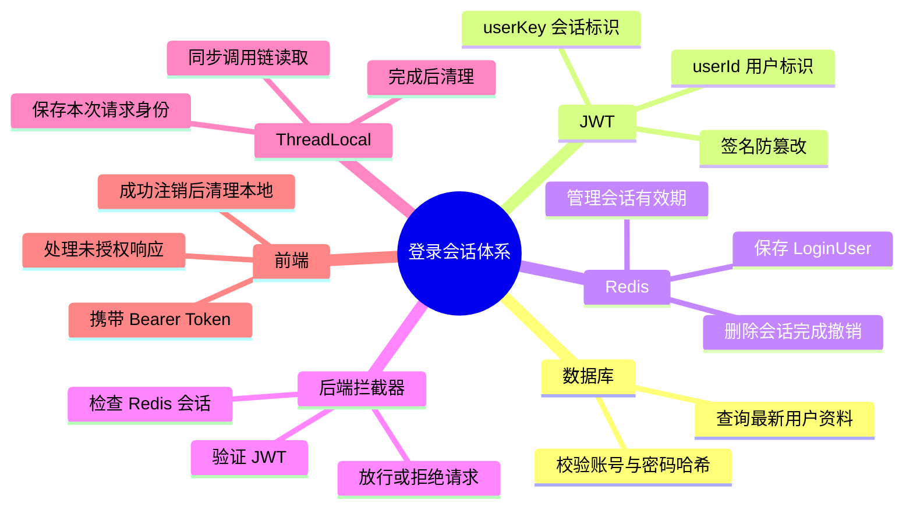
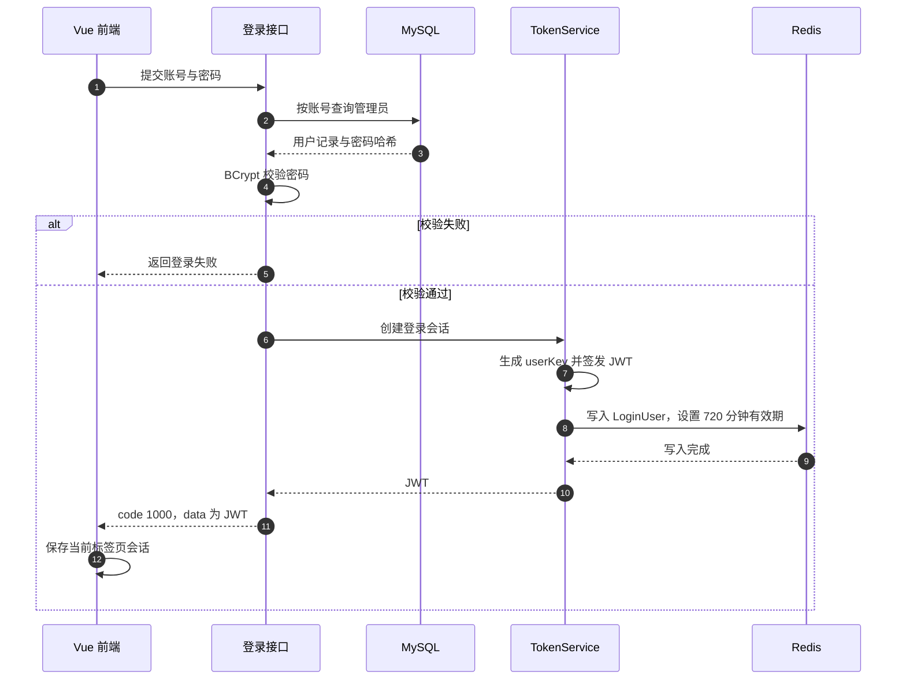
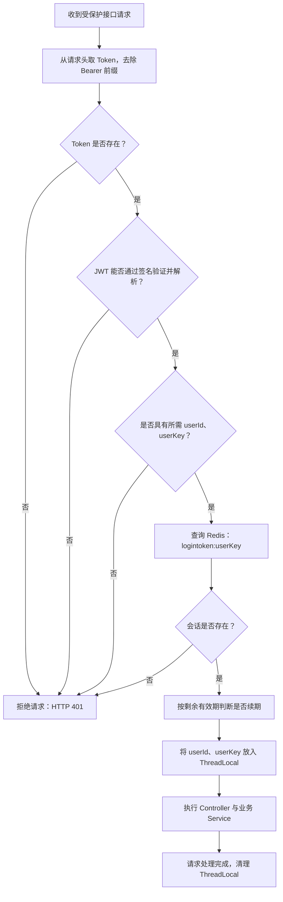
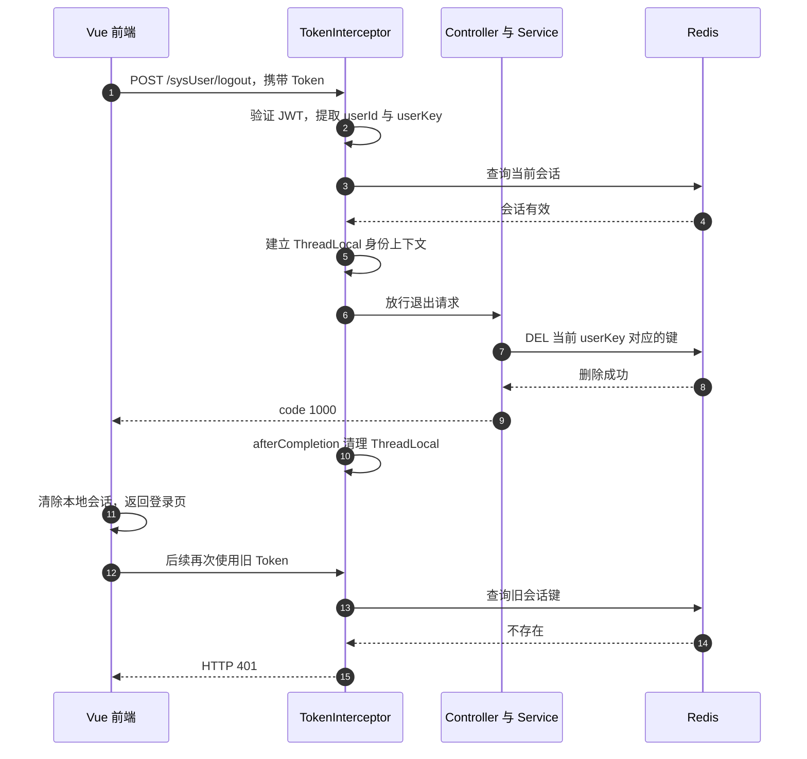

# 从登录到退出：一篇串起 JWT、Redis、拦截器与 ThreadLocal

> JWT 负责携带可验证的身份声明，Redis 负责保存仍然有效的登录会话，后端拦截器负责把关，ThreadLocal 负责在当前请求中传递已经验证的身份。退出登录，则是撤销服务器会话，而不只是让页面返回登录页。

“数据库里明明有管理员，为什么登录时还提示用户不存在？”

这个现象不一定是账号查询出错。前端的一次“登录操作”，可能实际包含两次 HTTP 请求：第一次校验账号密码并获取 Token，第二次携带 Token 获取当前用户信息。如果两次请求之间的身份传递链路断了，登录接口可以成功，用户信息接口却失败。

要真正理解这个过程，需要把几个看似独立的概念串在一起。本文以一个 Vue 3 + Spring Boot 3 的管理后台为例，沿着“登录 → 访问接口 → 获取资料 → 退出”的路径展开。

**阅读约定：** 下文的接口、类名、缓存结构与时间参数来自项目当前实现；标为“补充说明”或“后续改进”的内容不代表项目已经实现。流程图使用 Mermaid，示例用户 ID 和会话标识均为说明用途，不是真实凭证。

## 一、先分清：这几个组件到底各管什么？

可以把整套机制理解为“凭证、会话、入口、上下文”的配合。

| 组件        | 当前项目中的职责                                  | 不负责什么                                 |
| ----------- | ------------------------------------------------- | ------------------------------------------ |
| 数据库      | 保存管理员账号、密码哈希和用户资料                | 不替每次请求自动识别当前用户               |
| JWT         | 携带用户 ID、会话标识等声明，并通过签名机制防篡改 | 不能单独完成主动注销                       |
| Redis       | 保存登录会话及其有效期，支持续期和撤销            | 不替代密码校验，也不只是可有可无的查询缓存 |
| 后端拦截器  | 在进入 Controller 前验证 Token 与 Redis 会话      | 不是前端路由守卫                           |
| ThreadLocal | 在当前请求的同步执行链中暂存已验证身份            | 不是线程池，也不是跨请求会话仓库           |
| Vue 前端    | 保存并发送 Token，处理登录失效，发起退出请求      | 不决定服务端是否信任某个用户身份           |

### 1.1 用一张思维导图建立关系



有三个名称尤其容易混淆：

- **`userId`：用户唯一标识。** 用于确定数据库里的哪一位用户。
- **`userKey`：登录会话标识。** 当前项目每次创建 Token 都生成新的 UUID，用它定位 Redis 会话。
- **`identity`：身份类别。** 当前 `LoginUser` 用它区分普通用户和管理员，不是用户 ID，也不是会话 ID。

同一个 `userId` 可以对应不同的 `userKey`：例如同一账号在两个浏览器分别登录，就会产生两条会话。

## 二、登录时：为什么 JWT 和 Redis 要一起创建？

### 2.1 先证明账号密码正确，再建立登录会话

当前登录接口是：

```http
POST /sysUser/login
Content-Type: application/json

{
  "userAccount": "example_admin",
  "password": "<用户输入的密码>"
}
```

后端按账号查询用户，使用 BCrypt 校验输入密码与数据库密码哈希。只有校验通过，才会调用 `TokenService.createToken(...)`。

这一步做了两件彼此配套的事：

1. 创建包含 `userId`、`userKey`、`nickName` 的 JWT。
2. 以 `logintoken:<userKey>` 为键，把 `LoginUser` 保存到 Redis，并设置有效期。



### 2.2 Redis 中保存的不是 JWT 原文

JWT 的载荷可以概念化为：

```json
{
  "userId": 42,
  "userKey": "session-a",
  "nickName": "示例管理员"
}
```

Redis 中对应的结构则是：

```text
Key:   logintoken:session-a
Value: LoginUser {
         nickName: "示例管理员",
         identity: 2,
         headImage: null
       }
有效期: 720 分钟
```

这是帮助理解的结构示意，不是 Redis 的实际序列化文本。当前 `LoginUser` 本身没有保存 `userId`；用户 ID 来自经过验证的 JWT，会话存在性则由 Redis 确认。

因此，“退出时从 Redis 删除 Token”更准确的说法是：

> 删除该 Token 的 `userKey` 所对应的登录会话记录。

### 2.3 签名，不等于加密

当前 `JwtUtils` 使用 HS512 签发 Token，并通过服务端密钥验证。这里的“签名”提供完整性校验，不是把载荷加密；JWT 的声明可以以签名或加密等不同形式承载，不能把 JWT 与“密文”画等号。[1]

前端可以解码昵称来展示，但“能解码”不等于“已验证”。当前项目的身份判定仍由后端完成，不能让前端解析出一个 `userId` 后，就把它当成可信身份提交给服务器。

## 三、访问接口时：后端拦截器才是真正的检查入口

登录后，前端访问 `GET /sysUser/info`，请求头带上：

```http
Authorization: Bearer <token>
```

注意，这里没有要求前端传 `userId`，也没有要求把 Token 放进 URL。

### 3.1 前端请求封装与后端拦截器，不是一回事

前端 Axios 请求封装负责把 Token 附加到请求头；路由守卫负责页面跳转体验。这些逻辑都不是后端信任身份的依据。

后端 `TokenInterceptor` 实现 Spring MVC 的 `HandlerInterceptor`。它的 `preHandle()` 在 Controller 执行前运行：返回 `true` 才继续执行，返回 `false` 就停止后续处理。[2]

当前受保护接口的处理顺序如下：



这张图是正常输入与会话失效场景的主线。Redis 连接异常等基础设施故障不等于“用户未登录”，不能为了放行而跳过会话检查；不符合预期类型的声明也应在生产实现中明确拒绝，而不是放任转换异常变成笼统的服务错误。

### 3.2 两道检查分别解决什么问题？

**第一道：JWT 验证。** 确认声明没有在缺乏服务端密钥的情况下被任意修改。

**第二道：Redis 会话检查。** 确认这次登录仍被服务器认可，没有过期或被撤销。

由当前代码可知，只有签名可解析还不够。Redis 中对应的会话不存在，拦截器就会拒绝请求。

这也是为什么当前方案应称为：

> **JWT + Redis 的有状态登录会话方案，而不是完全无状态 JWT。**

其收益是能够主动撤销会话；代价是受保护请求依赖 Redis 的可用性。

### 3.3 拦截器必须真正注册，才会起作用

`WebMvcConfig` 中的注册规则是：

```java
@Override
public void addInterceptors(InterceptorRegistry registry) {
    registry.addInterceptor(tokenInterceptor)
            .excludePathPatterns("/sysUser/login", "/test/**")
            .addPathPatterns("/**");
}
```

也就是默认拦截已匹配规则的请求，放行登录和测试路径。测试白名单是当前代码的开发便利，不能据此认为任意测试接口都适合公开到生产环境。

这里有两层条件：**拦截器与配置类先成为 Spring Bean，然后配置类把拦截器加入 MVC 的执行链。** 仅仅写一个 `@Component`，不代表所有微服务都能自动扫描到它。

公共模块通过 Spring Boot 自动装配导入时，还要确认它的注册清单。Boot 支持通过 `META-INF/spring/org.springframework.boot.autoconfigure.AutoConfiguration.imports` 声明候选配置。[3]

## 四、ThreadLocal：它不是线程池，而是当前线程的“身份便签”

### 4.1 为什么验证完 Token，还需要它？

拦截器已经拿到了可信的 `userId` 和 `userKey`，后面的 Controller 还要使用这些信息。如果每一层都重新读请求头、解析 Token、查 Redis，会把认证逻辑散落到业务代码里。

ThreadLocal 提供了另一种方式：把值关联到当前线程，后续在同一个线程执行的代码可以读取它。不同线程有各自的变量槽位；`remove()` 则移除当前线程对应的值。[4]

项目在拦截器放行前执行：

```java
ThreadLocalUtil.set(Constants.USER_ID, userId);
ThreadLocalUtil.set(Constants.USER_KEY, userKey);
```

用户信息接口读取这些值：

```java
@GetMapping("/info")
public Result<SysUserVO> info() {
    Long userId = ThreadLocalUtil.get(Constants.USER_ID, Long.class);
    return sysUserService.getUserInfo(userId);
}
```

Service 再按这个 ID 查询数据库，返回账号与昵称。

**这里的 `userId` 是后端验证 JWT 后写入的，不是浏览器传入的查询参数。** 查询数据库使这个接口获得当前用户资料，而不是直接回显 JWT 或 Redis 中登录时的昵称快照。

### 4.2 线程池与 ThreadLocal 有什么区别？

| 概念        | 解决的问题                       | 可以怎样理解           |
| ----------- | -------------------------------- | ---------------------- |
| 线程池      | 哪个工作线程执行任务             | 分配工作人员           |
| ThreadLocal | 当前线程执行时携带什么数据       | 工作人员自己的便签     |
| Redis 会话  | 两次不同请求之间，登录是否仍有效 | 服务器共享的会话登记簿 |

对于当前同步 Spring MVC 请求，可以这样理解：

```text
工作线程 A：处理用户甲请求
    拦截器：写入 userId = 42
    Controller：读取 userId = 42
    请求结束：remove()

工作线程 B：处理用户乙请求
    拦截器：写入 userId = 87
    Controller：读取 userId = 87
    请求结束：remove()
```

这不意味着同一个用户始终由同一个线程服务，也不意味着每来一个请求都创建新线程。身份必须由每次请求重新验证并建立，不能依赖线程“记住”上次用户。

### 4.3 为什么一定要清理？

ThreadLocal 关联的是线程，不会因为业务认为“这次请求完成了”就自动等价于数据清空。[4]

当工作线程被复用时，如果旧数据没有清理，而下一条执行路径又没有正确覆盖就读取，可能使用到上一条请求残留的身份。

当前拦截器在 `afterCompletion()` 中调用：

```java
@Override
public void afterCompletion(HttpServletRequest request,
                            HttpServletResponse response,
                            Object handler,
                            Exception ex) throws Exception {
    ThreadLocalUtil.remove();
}
```

需要保留一个重要边界：Spring 只在该拦截器的 `preHandle()` 成功返回 `true` 后，才调用其 `afterCompletion()`。当前代码把身份写入放在验证通过后、放行之前；以后若提前写上下文又拒绝请求，就需要自己保证失败路径的清理。[2]

**清理 ThreadLocal 不是退出登录。** 它只是结束这一次请求的身份上下文，Redis 会话可以继续存在，下一次请求仍然可以携带 Token 重新验证。

### 4.4 项目实际使用的是 TransmittableThreadLocal

`ThreadLocalUtil` 内部声明的是：

```java
private static final TransmittableThreadLocal<Map<String, Object>> THREAD_LOCAL =
        new TransmittableThreadLocal<>();
```

它是阿里 TTL 提供的增强实现，不是线程池。遇到线程池任务时，需要配合任务包装、执行器包装或 Agent 等适配机制进行上下文传递；不能仅因声明了这个类，就认为所有异步调用都能正确继承身份。[5]

补充说明：线程变量隔离也不是对其中对象进行自动深拷贝。跨线程传递可变 Map 时，要额外考虑引用共享；当前同步请求的说明不能直接推广到所有异步和响应式链路。微服务之间的网络调用也不会自动传递 ThreadLocal。

顺便区分两个同名缩写：Redis 的 **TTL** 是键的剩余生存时间，阿里 **TTL** 是 TransmittableThreadLocal 这个库，二者不是同一种技术。

## 五、Redis 管的不只是“缓存”：过期、续期与主动退出

### 5.1 当前会话到底多久失效？

按当前代码中的常量：

```java
public final static long EXP = 720;
public static final long REFRESH_TIME = 3;
```

这些值在相关调用中都使用 `TimeUnit.MINUTES`：登录时设置 **720 分钟，即 12 小时**；通过会话验证的请求，如果剩余有效期读数小于 **3 分钟**，则尝试恢复到 720 分钟。

不是“小于 180 分钟”，也不是“每次请求都会重新设置 12 小时”。续期发生在接近到期且有请求到达时，不是后台定时任务。

当前 `extendToken()` 调用的是 Redis 过期时间操作，**延长的是会话键的有效期，并没有重新签发 JWT**。Redis 支持通过再次设置过期时间更新已有键的寿命。[6]

### 5.2 不要把 Redis 过期时间写成 JWT 自身的 exp

当前 `JwtUtils.createToken()` 没有设置 `exp`，创建声明的调用处也没有放入该字段。因此不能说“本项目的 JWT 自带 12 小时到期时间”。

准确说法是：

> 当前登录有效期主要由 Redis 会话控制；JWT 本身没有设置独立的 exp 截止时间。

JWT 标准中的 `exp` 用来声明 Token 自身的截止时间；它不是因为 JWT 这个名字存在，就自动产生的字段。[1]

如果后续给 JWT 增加绝对过期时间，那么“Redis 仍有效”和“JWT 尚未过期”都必须满足。只续 Redis，不能延长 Token 内已经签定的 `exp`；超过绝对时限后需要重新认证或设计明确的刷新流程。

### 5.3 退出登录为什么必须通知后端？

只删除前端存储的 Token，服务器上的 Redis 会话仍然存在。假如有人持有同一份 Token，仍可能继续通过当前会话检查。

因此，当前退出接口定义为：

```http
POST /sysUser/logout
Authorization: Bearer <token>
```

不需要请求体，也不需要前端提供 `userId` 或 `userKey`。拦截器先验证当前登录状态，再把可信的会话标识放入请求上下文。

Controller 的核心实现是：

```java
@PostMapping("/logout")
public Result<Void> logout() {
    String userKey = ThreadLocalUtil.get(Constants.USER_KEY, String.class);
    return sysUserService.logout(userKey);
}
```

Service 使用该会话标识执行撤销：

```java
@Override
public Result<Void> logout(String userKey) {
    return tokenService.deleteLoginUserByUserKey(userKey)
            ? Result.ok() : Result.fail(ResultCode.FAILED_UNAUTHORIZED);
}
```

最终删除的键就是 `logintoken:<userKey>`。Redis 的 `DEL` 移除指定键，并返回实际移除的数量；不存在的键不会被再次删除。[7]

### 5.4 从点击按钮到旧 Token 失效



图中最后一次旧 Token 请求用于说明撤销效果，正常前端退出后不会主动这样请求。

这里的“失效”是指：**对于会继续检查 Redis 的后续请求，旧 Token 不再被接受。** JWT 字符串没有被远程擦除，其签名也不会因为删除 Redis 就改变。已经通过鉴权、正在执行中的请求，不会被这次删除自动中断。

### 5.5 退出的是这次登录，不是这个账号的全部登录

假设同一用户有两条会话：

```text
浏览器 A：userId = 42，userKey = session-a
浏览器 B：userId = 42，userKey = session-b

Redis：
logintoken:session-a
logintoken:session-b
```

A 退出时只删除 `logintoken:session-a`，B 的会话仍然存在。

这是当前项目的“退出当前会话”。“强制所有设备下线”需要额外的用户到会话索引或其他失效机制，不能假定删除一个键就已经完成。

### 5.6 重复退出、失败与前端清理如何处理？

当前接口遵循“只有处于登录状态才能退出”的要求：

| 场景                                      | 后端当前行为                 | 前端处理                           |
| ----------------------------------------- | ---------------------------- | ---------------------------------- |
| 有效会话，删除成功                        | HTTP 200，业务码 1000        | 清除本地会话并跳转登录             |
| 没带 Token、Token 无效或 Redis 会话已失效 | 拦截器返回 HTTP 401          | 按登录失效清理会话                 |
| 鉴权后会话恰好消失，删除返回 false        | HTTP 200，业务码 3001        | 同样按登录失效处理                 |
| Redis 删除抛出异常                        | 返回服务失败，不报告注销成功 | 显示错误，允许重试                 |
| 网络超时，未收到明确响应                  | 前端不能确定服务器是否已删除 | 提示重试，不能声称服务器仍保留会话 |

Redis `DEL` 对不存在的键不会产生额外删除，但这不代表当前 HTTP 接口每次都会返回成功：第二次请求可能先被拦截器拒绝。[7]

**补充说明：** 另一种常见设计是把“已经退出”也视为成功，以简化客户端重试。当前项目选择的是严格检查登录状态，两者属于接口语义的取舍。

当前前端还做了一个容易忽略的保护：等待退出响应时，如果用户已经建立了另一个新会话，旧退出请求不能把新 Token 一起清除。因此本地清理前会比较当前 Token 与发起退出时的 Token。

## 六、一个实际故障：为什么登录成功，页面却说“用户不存在”？

现在可以回到开头的问题。

前端登录流程是：

```text
POST /sysUser/login
    ↓ 获取 Token 并暂存
GET /sysUser/info
    ↓ 获取服务端确认的用户资料
进入工作台
```

当第二步失败时，页面也会显示错误。因此看到登录页上的提示，不能立即断定第一个登录接口失败。

本项目曾出现：

| 请求                  | 返回结果                |
| --------------------- | ----------------------- |
| `POST /sysUser/login` | 业务码 1000，登录成功   |
| `GET /sysUser/info`   | 业务码 3102，用户不存在 |

根因不是数据库缺少管理员，而是公共安全模块中的拦截器没有真正注册到 Spring MVC。

启动类默认扫描 `com.amadeus.system`，而拦截器在 `com.amadeus.common.security`。原来的自动装配清单只包含异常处理器和 TokenService，遗漏了拦截器与 MVC 配置，造成这条链路：

```text
/info 未经拦截器
    ↓
ThreadLocal 中没有 userId
    ↓
Controller 读取到 null
    ↓
按空 userId 查询用户
    ↓
返回“用户不存在”
```

修复是在安全模块的自动装配清单中补齐：

```text
com.amadeus.common.security.handler.GlobalExceptionHandler
com.amadeus.common.security.service.TokenService
com.amadeus.common.security.interceptor.TokenInterceptor
com.amadeus.common.security.config.WebMvcConfig
```

再重新构建并重启服务，让 Spring 重新建立容器和拦截器链。

这个问题说明：**类文件存在，不代表 Bean 已注册；Bean 已注册，也不代表已经加入请求执行链。**

排查这类问题时，先看浏览器 Network 中究竟是哪次请求失败，再验证无 Token 访问受保护接口是否返回 401。不要一上来就修改数据库账号、密码或给用户 ID 增加默认值。

测试同样需要覆盖真实自动装配路径。若测试中手动把拦截器加入 MockMvc，只能证明拦截器逻辑可用，不能证明应用启动时会自动加载它。

## 七、理解当前方案之后，还要记住哪些边界？

下面是理解和后续完善的方向，不是已经完成的功能清单。

1. **认证不等于授权。** 当前拦截器检查 JWT 与会话有效性，但没有使用 `LoginUser.identity` 完成细粒度管理员权限判定。“已经登录”与“允许执行这项操作”仍需分别处理。
2. **会话时间需要统一设计。** 当前没有 JWT 的绝对 `exp`，接近到期的有效请求可以再次续期；如果业务要求最长连续登录时间，应明确增加绝对时限，而不是误把 Redis 的滑动续期当成绝对上限。
3. **刷新资料时不能无意清除 Redis 有效期。** 当前 `refreshLoginUser()` 使用不带过期时间的写入方法覆盖会话；按 Redis 普通 `SET` 语义，这会丢弃原 TTL。该方法不能被当成“天然保留有效期”的更新接口，后续应显式保留或重新设置有效期。[8]
4. **异步任务需要单独管理上下文。** 包括传播、对象共享和清理，不能直接复用“单线程同步请求”的全部假设。Spring MVC 异步处理也有不同的拦截器回调生命周期。[2][5]
5. **不要把完整 Token 写进日志。** 当前 Token 解析异常日志仍包含原始 Token，后续应改为不记录凭证原文的诊断信息。
6. **生产安全入口需要进一步体系化。** Spring 官方提示 MVC 拦截器可能与控制器路径匹配存在差异，建议使用 Spring Security 或尽早接入 Servlet Filter 链的同类机制。本文解释的是当前项目的拦截器实现，不把它包装成所有生产系统的最终安全架构。[9]

## 结语：把职责分开，登录链路就不再神秘

整套机制可以浓缩成五句话：

- **JWT：** 携带可以验证的用户与会话声明。
- **Redis：** 管理这次登录是否仍然有效。
- **后端拦截器：** 在业务代码执行前完成认证检查。
- **ThreadLocal：** 为当前请求暂存并传递已验证的身份，完成后清理。
- **退出登录：** 撤销当前 Redis 会话，再由前端清除本地凭证。

最后用三个问题检查自己是否真正理解：

1. JWT 签名仍然正确，为什么退出后旧 Token 也可能被拒绝？
2. 每次请求都清理 ThreadLocal，为什么用户不会每次请求后都退出？
3. 登录接口成功，为什么获取当前用户信息仍然可能失败？

如果能够分别从“会话状态”“请求上下文”“拦截器注册链路”解释这三个问题，就已经掌握了这套登录机制的主线。

## 参考资料

以下资料用于补充通用原理；接口路径、业务码、缓存结构和具体常量以本文分析的项目实现为准。

1. [RFC 7519：JSON Web Token，含 exp 声明](https://www.rfc-editor.org/rfc/rfc7519.html)
2. [Spring Framework 6.0.3：HandlerInterceptor API](https://docs.spring.io/spring-framework/docs/6.0.3/javadoc-api/org/springframework/web/servlet/HandlerInterceptor.html)
3. [Spring Boot 3.0.1：Locating Auto-configuration Candidates](https://docs.spring.io/spring-boot/docs/3.0.1/reference/html/features.html#features.developing-auto-configuration.locating-auto-configuration-candidates)
4. [Java 17：ThreadLocal API](https://docs.oracle.com/en/java/javase/17/docs/api/java.base/java/lang/ThreadLocal.html)
5. [TransmittableThreadLocal 2.14.5 API](https://alibaba.github.io/transmittable-thread-local/apidocs/2.14.5/com/alibaba/ttl/TransmittableThreadLocal.html)
6. [Redis：EXPIRE](https://redis.io/docs/latest/commands/expire/)
7. [Redis：DEL](https://redis.io/docs/latest/commands/del/)
8. [Redis：SET 与 TTL](https://redis.io/docs/latest/commands/set/)
9. [Spring Framework：Interception 与安全层边界](https://docs.spring.io/spring-framework/reference/web/webmvc/mvc-servlet/handlermapping-interceptor.html)
